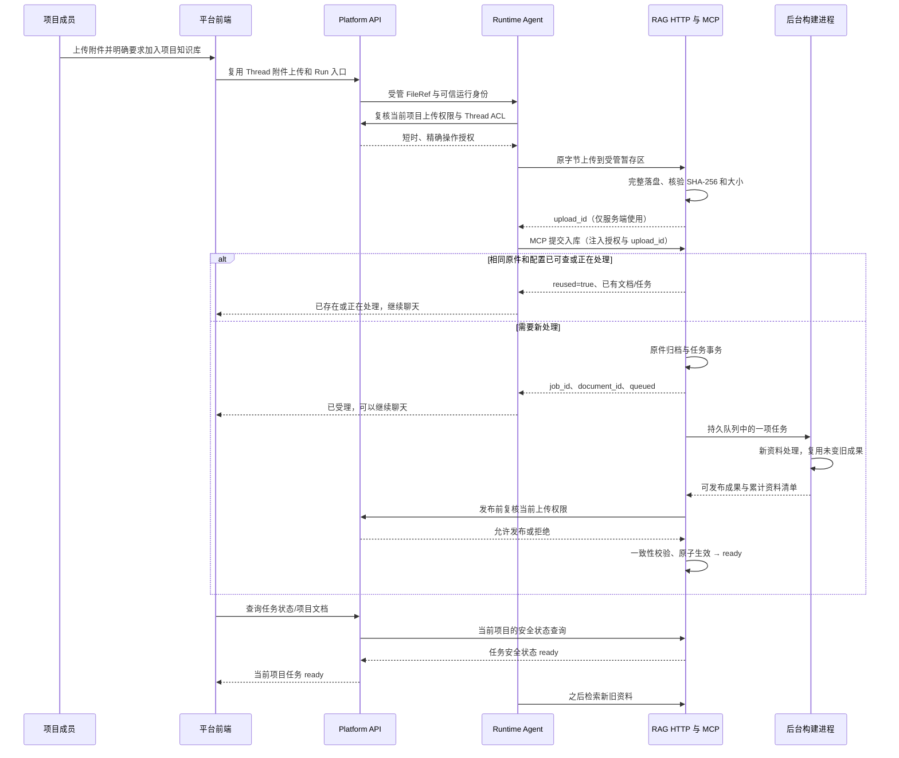

# 项目成员通过 Agent MCP 异步入库：细化方案

> 2026-10-12。用户先确认规划，后授权G01、K01–K08及RAG配置实施。G01完整快照原生增量门禁与RAG文本范围已通过，证据见第8节/implementation；平台和前端由对应团队接续，整专项partial，未部署。原“每次上传无缓存全量重建”推荐已被实测单一路线取代。

## 1. 需求和用户行为

用户在 AI 平台选择当前项目、上传聊天附件，并说“把这份资料加入项目知识库”。Agent 调用入库工具后获得任务 ID，可以继续回答；解析和索引在 RAG 服务后台进行。发布成功后，同项目其他成员也能检索该资料，全部历史资料同时保留。

**项目可检索集合累计增加，不用新文件替换旧资料，也不要求每次重新处理旧文件。** 例如 r1 可查 A、B，上传 C 后 r2 可查 A、B、C；再上传 D 后 r3 可查 A、B、C、D。构建期间旧资料仍可查；未完成的新资料不承诺可检索。revision 是查询视图版本，具体索引构建方式由第8节验证后确定。

成本是首版验收条件：相同项目内相同原件、处理配置相同且已可查时，重复提交不重新解析、不新增入库 Embedding/抽取请求；正在处理时复用原任务。新增 C 不批量重新解析、抽取或 Embedding 未变化的 A、B。新内容影响旧实体/关系而产生的必要合并调用单独统计，不承诺所有旧实体向量永远不变。

上传聊天附件本身不自动共享。工具说明和前端入口明确“加入后项目成员均可查询”；普通阅读文件、`parse_document` 和单纯聊天上传不触发入库。用户同意自动生效是免管理员内容审核，会话原有工具审批规则仍有效。

## 2. 现状依据及缺口

文中 K 是 `/Users/lijiaxin/PyCharmMiscProject/research/rag-anything-use`，P 是 `/Users/lijiaxin/.codex/worktrees/6394/ai-agent-platform`。下表保留实施前实际读取的源码依据；当前K状态以tasks和implementation证据为准。

| 入口 | 当前事实 | 本次需要补充 |
|---|---|---|
| K `src/mcp_server.py:create_server()` | 3 个只读工具；lifespan 为所有固定 namespace 持读锁并初始化 | 受管上传/任务工具、后台生命周期、按逻辑库解析当前版本 |
| K `src/knowledge/ingest_service.py:KnowledgeIngestService.ingest_document()` | CLI 入库用独占锁；已发布 namespace 抛 `published_namespace_immutable` | 复用解析与索引，内部支持稳定 document_id；写入新的 staging namespace |
| K `src/knowledge/publication.py:namespace_lock()/validate_publication()` | flock 防并发，发布标记、签名、manifest、ready 检查 | 保留这些检查；验证增量成果如何安全形成可发布版本 |
| K `src/knowledge/auth.py:KnowledgeScope/KnowledgeTokenVerifier` | 固定 Bearer → tenant/project/namespace，只有 `knowledge:read` | 增加显式逻辑库模式；上传还需要平台当前授权，不能靠静态 Bearer 提权 |
| K `src/knowledge/document_registry.py` | 原子替换 documents.json；适合单版本 manifest，不是任务队列事务 | 保留版本 manifest；新增 SQLite 保存任务、文档原件和 active 指针 |
| K `src/knowledge/rag_engine.py:ProjectRAGEngine` | 引擎按 namespace 缓存；workspace 根据目录绝对路径 hash 生成 | 每个版本独立 workspace；按版本关闭缓存与保护在途查询 |
| P `apps/platform-api/src/platform_api/modules/runtime_gateway/application/service.py:upload_thread_file()` | Thread ACL、MIME/20 MiB 校验，转发原始文件到 Runtime | 原附件链复用；新增项目知识治理和当前权限复核 |
| P `apps/platform-api/src/platform_api/modules/projects/service.py:get_access()` | 从当前成员/服务账号授权读角色和权限 | 复用查询，新知识权限登记到 IAM |
| P `apps/runtime-service/src/runtime_service/tools/mcp.py:load_mcp_tools()` | 仅允许 `mcp_` 名称、服务端绑定和 readOnlyHint=true | 精确接纳一个知识上传工具；禁止全局放开写 MCP |
| P `apps/runtime-service/src/runtime_service/workspace/file_refs.py` | 六字段 FileRef；仅 `/workspace/uploads/<sha256>.<ext>`，20 MiB | 从当前 Thread 已登记附件核对引用，再传原字节 |
| P `apps/runtime-service/src/runtime_service/runtime/access_policy.py:interrupts_for_access_policy()` | review/workspace_write/full_access 已有工具审批策略 | 上传属于项目共享写入，不加入 WORKSPACE_WRITE_TOOLS |

当前“服务启动后不能继续向同一知识库入库”有两个独立原因：运行时共享锁与 published namespace 不可变。只移除锁仍会被不可变检查拒绝，也会破坏多存储一致性。

LightRAG 1.4.12 本身支持向既有库追加文档；当前不能在线上传是应用的读锁、发布规范和缺少上传/任务入口共同造成。文件 KV/向量/图存储有各自刷新流程，不能把复制 `rag_workdir` 或直接写正在查询的索引当成已证明安全的更新方案。已发布 namespace 不可变仍是现行约束；本专项先验证增量处理与安全发布的组合。

### 2.1 去重和异步能力的源码依据

| 证据 | 已核对行为 | 对本项目的限制 |
|---|---|---|
| LightRAG 1.4.12 `lightrag.py:apipeline_enqueue_documents()` | 默认按规范化正文生成 MD5 文档ID；同批正文去重，再用 `doc_status.filter_keys()` 排除已有ID | 显式传入ID时跨次过滤依据是ID，不是原文件SHA-256；不能免除之前的PDF/Office解析 |
| K `ingest_service.py:_ingest_document()`、`rag_engine.py:ingest_text()/ingest_content_list()` | 每次生成随机 `kd_{uuid}`，并显式传给 LightRAG/RAGAnything | 相同原件再次提交可能重新走入库流水线；需要应用层解析前去重和稳定ID |
| 锁定 RAGAnything 1.2.10 `processor.py:_generate_cache_key()/parse_document()` | 解析缓存key包含绝对路径、mtime、parser、parse_method及相关参数 | 换路径/修改时间未必命中；不能当作项目内原件hash去重。已核对与 `uv.lock` hash一致的wheel源码，本机未安装documents extra |
| LightRAG `kg/nano_vector_db_impl.py:upsert()` | 对输入批次调用 embedding_func；chunk ID相同本身不保证跳过Embedding | 不能把“chunk有hash”或LLM cache开关当作已验证的Embedding缓存 |
| LightRAG `api/routers/document_routes.py:upload_to_input_dir()` | 保存上传文件后用BackgroundTasks处理，返回track_id；正文重复在抽取内容后判断 | 这是可借鉴的异步交互；当前K未挂载此上传路由，其文件名去重、鉴权和进程内任务不替代本次项目隔离与持久job |

原件hash、正文hash、解析缓存、Embedding缓存分别解决不同阶段的问题。首版原件SHA-256去重必须做；解析后正文hash识别“字节不同但正文相同”可以后置。解析/OCR、图实体关系抽取LLM、Embedding、查询模型费用分开观察；去重的零新增入库调用不包含用户本次聊天的Agent思考和正常检索费用。

## 3. 最小完整架构



MCP 负责“提交任务、查询状态、检索”。文件字节走受管 HTTP；不会把全文/base64 放入模型工具参数或 checkpoint。仍是用户通过 MCP 使用的知识能力，文件传输是工具内部实现。

只增加 RAG 自身的任务存储，不在平台或 Runtime 建第二份入库队列。首版一个 RAG 服务主进程管理队列，每次一个构建子进程；不增加 Redis/Celery、独立登录系统、Agent 轮询循环或 Docker。

| 发布方式 | 收益 | 代价与结论 |
|---|---|---|
| 原生增量处理＋完整发布边界 | 复用LightRAG入库能力，仅处理新文档及受影响图数据 | 优先做G01验证；必须同时满足旧查询不中断、失败不污染、已发布namespace不变 |
| 项目内成果/精确模型缓存＋新候选版本 | 保留单版本检索与不可变发布，跨版本复用原件解析和未变模型输入的结果 | 原生方式不通过时评估；仍有CPU/磁盘与图合并成本，缓存覆盖不足不能冒充零重复费用 |
| immutable base＋有限delta、查询合并 | 保留旧索引，新增资料单独处理 | 仅备选；查询次数、排序/来源、跨文档图关系和后续压缩更复杂，需单独比较再评审 |
| 每次无缓存全量重新入库 | 发布与回退直观 | 不满足本次成本目标，不作为默认上传实现；模型/解析语义变更的显式管理员重建另计 |

这些复杂度来自“可靠后台任务、当前项目授权、累计可查询”三条需求；首版没有额外引入目录、分享链接、内容审核或通知系统。

“异步”在首版是工具立即返回业务job_id、RAG后台执行，不要求客户端升级为MCP原生tasks协议。锁定FastMCP含Docket任务能力，但其worker依赖Redis，现有LangChain Adapter按普通call_tool接线；本需求可用提交/状态两个工具完成，避免引入新的协议协商和任务中间件。

## 4. 各层职责和代码位置

### 4.1 RAG 服务：持有原文件、任务与索引

现有文件继续作为 CLI/MCP 共用引擎；新增文件名和符号是规划，实施时以职责为准，不机械拆出接口层和基类。

| 文件 | 现有/拟新增符号与具体改动 |
|---|---|
| K `src/mcp_server.py` | 修改 `create_server()`：注册新增工具、内部 HTTP 路由和 supervisor；legacy 只读模式仍可独立使用 |
| K `src/knowledge/auth.py` | 修改 `KnowledgeScope`：`namespace`（legacy）或 `knowledge_base_id`（online）必须且只能选一项；核验逻辑库归属，禁止隐式创建和公共回退 |
| K `src/knowledge/jobs.py` **新增** | `KnowledgeJobStore`：stdlib sqlite3、任务/文档/版本事务、幂等、分页、active 指针；schema_version 初建和升级检查 |
| K `src/knowledge/upload_service.py` **新增** | `KnowledgeUploadService.stage_upload()/submit_document()/get_job()`：受管原文件、内容校验、一次性上传票据和任务受理；HTTP/MCP 共用 |
| K `src/knowledge/http_routes.py` **新增** | `register_knowledge_routes()`：使用 FastMCP 已有 custom_route/Starlette 路由，接收原字节并返回安全 DTO；HTTP 路由单独显式鉴权 |
| K `src/knowledge/job_worker.py` **新增** | `KnowledgeJobSupervisor`、构建子进程入口：顺序消费、阶段报告、限时、所有权锁、进程回收、重启恢复 |
| K `src/knowledge/generations.py` **新增** | `KnowledgeGenerationService.build()/activate()/acquire()`：累计可查清单、稳定ID、候选版本、在途读lease、原子生效与回退；build内部以G01通过的方式复用旧成果，不默认循环重做全部原件 |
| K `src/knowledge/artifacts.py` **拟新增** | 项目内解析成果的保存、签名匹配与损坏检查；若G01选择跨版本模型缓存，在同一任务库登记精确缓存，不新建第二个任务系统 |
| K `src/knowledge/ingest_service.py` | 给内部入库用例传稳定 `document_id`、安全显示名和受管原文件；保留 CLI 公共签名以及对已发布 namespace 的拒写 |
| K `src/knowledge/rag_engine.py`、`src/demo_support.py` | 前者按版本回收/刷新引擎，复用已有入库/检索方法；后者 `build_embedding_func()/build_lightrag()/build_raganything()` 是模型hook入口，必要时最小注入项目内精确缓存和用量计数，保持CLI/examples默认行为 |
| K `src/knowledge/publication.py`、`document_registry.py`、`project_paths.py` | 复用 flock、manifest、签名与路径校验；补受管原文件路径和候选版本发布持久化，不放宽 namespace 校验 |
| K `src/knowledge/schemas.py`、`config.py` | 新任务/能力/提交 DTO、严格状态和限制，错误码白名单；默认关闭在线上传 |
| K `src/cli.py` | 新增管理员 `init-project-knowledge`、`migrate-project-knowledge`、`activate-knowledge-generation`；分别初始化、迁移、回退，禁止经 MCP 暴露 |
| K `env.example`、`pyproject.toml`、`uv.lock` | 补在线开关、平台授权地址/专用密钥占位；如直接使用 Starlette/httpx 则声明已安装包的直接依赖，不升级 LightRAG/FastMCP |
| K `tests/test_knowledge_jobs.py`、`test_knowledge_upload.py`、`test_knowledge_generations.py`、`test_knowledge_artifacts.py` **拟新增** | 事务、并发去重、模型调用计数、缓存签名、增量发布/失败和恢复；先补技术验证，不以文件复制替代验证 |

平台文档状态更新只在实施时进行：K `AGENTS.md` 的“只读 3 工具”改为“只读查询＋精确授权入库”，仍禁止管理员工具/宿主路径和修改已发布 namespace。同步现有 README、接入/运行指南与 FEATURES/CONTEXT，不把本草案当成生效规范。

### 4.2 Platform API：当前身份、权限、审计与安全投影

| 文件 | 现有/拟新增符号与具体改动 |
|---|---|
| P `apps/platform-api/src/platform_api/modules/iam/application/policies.py` | `PermissionCode/PROJECT_PERMISSION_MAP` 新增 `project.knowledge.read/upload`；admin/editor/executor 均可，沿当前服务账号 grant 规则；不修改 runtime.write |
| P `apps/platform-api/src/platform_api/modules/knowledge/router.py`、`service.py`、`schemas.py` **新增** | 简单模块：项目能力、已发布文档、任务列表/状态；内部 `authorize_knowledge_operation()`；用例复用 `ProjectsService.get_access()` 和 Thread ACL |
| P `apps/platform-api/src/platform_api/adapters/knowledge/client.py` **新增** | 受管 URL/Bearer 的异步 HTTP 调用，timeout、安全 DTO 校验；不接受浏览器指定 RAG 地址 |
| P `apps/platform-api/src/platform_api/entrypoints/http/router.py`、`bootstrap/lifespan.py`、`config.py` | 注册路由和 client 生命周期，服务端资源声明、授权专用配置；不增加平台业务表 |
| P `apps/platform-api/src/platform_api/modules/audit/http_resolution.py` | 注册知识读取/授权/发布前校验 action；actor、project、request/job 关联，拒绝/异常也留安全审计 |
| P `apps/platform-api/tests/test_knowledge_member_upload.py` **新增** | 成员矩阵、当前撤权、内网签名、资源归属、错误和 DTO；扩展 `test_audit_http_resolution.py`、`test_knowledge_mcp_bindings.py` |

URL/凭据保存在受管配置，沿现有 project→resource 映射核对归属。跨服务 HTTP 等待不持 DB 事务；同步权限查询在同一工作线程完成 Session 创建、查询和关闭，遵循现有开发范式。

### 4.3 Runtime：安全地执行一个 MCP 写工具

| 文件 | 现有/拟新增符号与具体改动 |
|---|---|
| P `apps/runtime-service/src/runtime_service/tools/mcp.py` | `load_mcp_tools()` 继续官方 MultiServerMCPClient；精确允许上传名称＋scope＋服务端开关，其他写工具仍拒绝；装配上传 interceptor |
| P `apps/runtime-service/src/runtime_service/tools/knowledge_upload.py` **新增** | `knowledge_upload_interceptor()`：读取可信 principal/tool runtime、当前 Thread 的附件记录，核对 FileRef/字节，调用平台授权，再上传和注入私有 headers；状态结果严格投影 |
| P `apps/runtime-service/src/runtime_service/tools/knowledge.py` | 保留检索来源限制；新增任务结果安全投影分支，不能把任务结果错误送入 sources schema |
| P `apps/runtime-service/src/runtime_service/runtime/mcp_config.py` | 校验知识上传配置及精确 allowlist；API/Worker 一致；不把配置、凭据放 Context |
| P `apps/runtime-service/src/runtime_service/runtime/capabilities.py` | 保留两主图显式支持；上传启用/权限/deny 不满足时不宣称可用 |
| P `apps/runtime-service/src/runtime_service/services/dearflow_agent/agent.py` | 在现有组合根接线上传审批与提示词，复用 `interrupts_for_access_policy()`；Plan/schema-only/offload/子图不获得写能力 |
| P `apps/runtime-service/src/runtime_service/services/demo/showcase_demo/agent.py` | 对齐相同通用能力和审批；不另写一套入库逻辑 |
| P `apps/runtime-service/src/runtime_service/workspace/file_refs.py`、`workspace/documents.py` | 复用 `validate_file_ref()/validate_file_path()/DocumentWorkspace.read()`；如需补完整原件读取只做最小补充，不改变六字段契约 |
| P `apps/runtime-service/tests/tools/test_knowledge_upload.py` **新增** | 附件归属/哈希/伪造引用、私有参数不入消息、幂等与错误；扩展现有 `test_knowledge_http_contract.py`、两图装配、Plan/审批测试 |
| P `apps/runtime-service/tests/e2e/test_knowledge_member_upload.py` **新增** | 真实模型调用 MCP、普通成员共享、新旧资料累计、撤权、Stop、故障与重启 |

官方 Adapter 锁定为 0.3.2，其 `MCPToolCallRequest.override(args=..., headers=...)` 支持拦截执行、运行身份注入和单次请求 headers。已核对本地源码及 [官方 reference](https://reference.langchain.com/python/langchain-mcp-adapters/interceptors/MCPToolCallRequest/override)，实施不因此升级依赖。复用 DeepAgents [现有 HITL](https://docs.langchain.com/oss/python/deepagents/human-in-the-loop)。

现有附件六字段没有 `attachment_id`。首版工具接受 FileRef，Runtime 将它与当前 Thread 中真实登记的引用逐字段核对；模型构造一个形式合法的引用不足以获得读取权限。显示名从可信登记引用取得，不能用哈希文件名代替原名称。`parse_document` 的截断工具结果不能作为全文入库来源。

这里“登记的引用”指当前Thread已接收用户消息中的FileRef记录，不假定已有独立附件数据库。与消息记录一致之后，仍必须沿现有resolve_thread_workspace，以可信tenant/project/thread/graph定位当前工作区，校验实际原件的hash/MIME/大小和无路径逃逸；同名信息来自经过安全校验的该用户附件名称。不得仅把模型args当成附件登记记录。

### 4.4 前端：复用聊天入口，补任务状态和项目资料列表

由用户同事实施。保留现有附件上传和消息发送，补明确的“加入项目知识库”意图、入库任务卡，以及小型项目资料/任务面板。具体组件、请求和验收见 [frontend-handoff.md](frontend-handoff.md)。不建设第二套 RAG 前端，不接收 RAG Bearer。

### 4.5 工业能力的取舍与外部服务边界

工业文件入库通常是“原件存储→元数据/任务事务→队列→解析→分块/图抽取/Embedding→索引生效→状态查询”。例如 [Dify文件入库与状态接口](https://github.com/langgenius/dify/blob/main/api/controllers/service_api/dataset/document.py) 返回document/batch，耗时索引异步执行；参考的是生命周期，不照搬它的部署拓扑，也不假定外部产品天然满足本项目全部去重语义。

| 能力 | 本期最小实现 | 后置触发条件 |
|---|---|---|
| 原件与任务 | 受管本地磁盘、SQLite WAL、单机单worker、恢复/超时 | 多实例或磁盘治理需要时再采用对象存储、外部元数据库/队列 |
| 大文件 | 沿用20 MiB附件上限，流式hash、有限资源解析、上传/处理两种状态 | 明确超过20 MiB需求后跨层增加分片/断点续传；不只提高接口参数 |
| 防浪费 | 原件hash唯一、稳定ID、进行中任务复用、成果复用、增量/缓存技术门禁和基本用量 | 正文hash、细粒度chunk复用在语料证明有收益时增加 |
| 可用性 | 新资料完成后生效、旧资料持续查、失败隔离、回退、项目权限/审计/配额 | 横向扩容、复杂通知/内容审核/多租户集群不在本期 |

数据库或向量库的“写入能力”不等于文档接收/解析/重试/权限能力。K承担本供应商缺失的入库生命周期；Platform API只提供当前权限和安全状态，Runtime只执行受管工具，不保存知识原件或索引、不重复建设处理队列。以后供应商已有上传/任务API就接入其能力；只有查询能力的资源应报告upload_enabled=false，不强行用K代替该供应商入库。本期不建设多供应商上传抽象层。

## 5. 接口契约

### 5.1 MCP

保留现有三个只读工具的签名与安全输出。online 模式下检索/文档列表在一次调用内固定 active generation；文档列表只列已发布资料。未完成入库的进度由新任务接口表达。

| 工具 | 参数 | 行为与 annotations |
|---|---|---|
| `mcp_submit_project_knowledge_document` **新增** | `file_ref`：现有六字段 FileRef | 必须有 Runtime 注入的上传票据＋当前平台授权；立即返回任务；readOnlyHint=false、destructiveHint=false、idempotentHint=true |
| `mcp_get_project_knowledge_ingest_job` **新增** | `job_id`：`kj_`＋32位小写hex | 只读查询同项目任务；未知/跨项目同样 not_found，不暴露归属 |
| `mcp_query_project_knowledge` **保留** | `query, top_k` | 一次检索累计已发布资料；sources 原契约保持 |

`tenant_id/project_id/namespace/knowledge_base_id/subject/credential/host_path/url/upload_id` 均不是模型工具参数。FileRef.path 是平台受管虚拟引用，RAG 不用它读取宿主机目录；RAG 使用自己的 upload_id 对应的受管原件。

新增工具返回单 JSON 文本与同值 structuredContent；Runtime 在 Adapter 转换前校验/脱敏。提交回执示例：

```json
{
  "version": 1,
  "job_id": "kj_11111111111111111111111111111111",
  "document_id": "kd_22222222222222222222222222222222",
  "file_name": "项目规范.md",
  "status": "queued",
  "searchable": false,
  "reused": false,
  "error_code": null,
  "created_at": "2026-10-12T04:00:00Z",
  "updated_at": "2026-10-12T04:00:00Z"
}
```

`status` 记录该次入库尝试，`searchable` 根据文档是否存在于当前已发布查询视图且签名兼容计算。首次成功生效时ready/true；之前通常为false。管理员回退后可能ready/false，失败尝试的同文档后来重提成功也可能failed/true，因此不能仅凭status推断当前可检索。

`reused` 只出现在提交回执，表示本次未新启动解析/索引：正在处理时返回原job和实际阶段；已可查时返回原文档和成功job。迁移的旧文档没有历史job时，允许 `job_id=null,status=ready,searchable=true,reused=true`，不为它伪造一次queued任务。该情况前端直接刷新资料列表，不调用null任务URL。复用前仍核对当前权限、scope和处理签名；原件相同但配置变化/当前不可查时不能伪报成功复用。任务GET返回原任务，不能修改原attempt的时间/状态来表达本次复用。

DTO 不含原文件路径、原始异常、模型正文、上传票据、内网地址或 private Thread 元数据。ToolResult 最多4 KiB；错误用MCP isError=true＋白名单code，任务执行失败则DTO为failed。建议补 `knowledge_queue_full`、`knowledge_processing_timeout`、`knowledge_content_conflict` 和 `knowledge_processing_config_changed` 的安全投影；未知上游异常不透传。

### 5.2 前端使用的 Platform API

均为拟新增路径，沿平台认证和统一 ErrorResponse；project_id 是路由范围，不是可信授权结论。

| 方法与路径 | 权限 | 返回 |
|---|---|---|
| `GET /api/projects/{project_id}/knowledge/capabilities` | 当前项目成员 | version、read/upload_enabled、supported_mime_types、max_file_bytes、disabled_reason |
| `GET /api/projects/{project_id}/knowledge/documents?limit=20&offset=0` | knowledge.read | `OffsetPage`：items、total；只列已发布文档 |
| `GET /api/projects/{project_id}/knowledge/jobs?limit=20&offset=0` | knowledge.read | `OffsetPage`：items、total；项目共享任务安全信息，不含来源 Thread/私有会话 |
| `GET /api/projects/{project_id}/knowledge/jobs/{job_id}` | knowledge.read | 上述任务 DTO，reused 仅提交回执出现 |

首版没有新的浏览器原文件上传接口：原文件复用 `PUT /api/langgraph/threads/{thread_id}/files/uploads/{sha256}`，保留原 `x-project-id`、Thread ACL 和六字段响应。加入知识库由明确的用户消息触发 MCP。项目面板仅列表和任务状态，不额外提供一套直传逻辑。

文档列表只列当前 active 中的累计资料，项为 `document_id,file_name,mime_type,size_bytes,status=ready,searchable=true,published_at`；无原文下载地址。任务项目共享只公开资料名称/阶段/安全错误，不暴露成员其他私有聊天内容。任务列表保留历史尝试，最多limit100，默认20；总数/offset用于分页。

### 5.3 服务端内部 HTTP

K 的内部路由与 `/mcp` 同端口，使用 FastMCP custom_route；这些普通 HTTP 路由**不能假定自动继承 MCP tool 鉴权**，必须显式核验 scope/Bearer、请求限制，写操作另验平台 grant。

| 方法与路径 | 消费方与用途 |
|---|---|
| K `PUT /internal/knowledge/uploads/{request_id}` | Runtime 流式传原字节；Bearer scope＋平台 upload grant；返回 opaque upload_id，原件落盘成功才响应 |
| K `GET /internal/knowledge/capabilities`、`/documents`、`/jobs`、`/jobs/{job_id}` | Platform API 使用受管项目 Bearer 获取安全 DTO，不接受 scope query 参数 |
| P `POST /api/runtime/internal/knowledge/authorize` | Runtime/RAG 使用专用服务签名调用；按 upload/start/activate 操作回查当前项目权限，返回短时 grant |

平台内部授权请求采用 `{"version":1,"values":{...},"signature":"<hex>"}`；专用key_id随请求携带，签名覆盖完整values。upload必填可信主体/归属/thread/run/tool_call/request_id/hash/size；start/activate用已持久job身份与scope，activate增加target/base revision。错误按平台ErrorResponse；K普通HTTP按同shape返回安全code；MCP按isError投影，三者均不回传原始堆栈。

上传票据为持久行，绑定 tenant/project/subject/credential/thread/request_id/sha256/size，5分钟内可消费一次；同请求重放返回原票据或原 job，不能跨用户/项目消费。MCP 的 `X-Knowledge-Upload-ID` 与 `X-Knowledge-Operation-Grant` 仅由 interceptor 注入，不进入模型/历史。完整原件保存到 RAG 后，Thread 过期或删除不会删除已受理的知识原件。

## 6. 权限与写入边界

1. 新增 `project.knowledge.read/upload`，admin/editor/executor 都是目标成员；沿平台当前项目成员/服务账号有效 grant 规则。无需给普通成员 `runtime.write` 或管理员身份。
2. Runtime 只对精确工具名称、服务端 resource binding、同 tenant/project、在线开关开启且未 deny 的组合允许写入。服务器其他 mutation 即便伪造 readOnlyHint 也不能绕过知识上传精确 schema 和 authorization；现有其他 MCP 保留原只读规则。
3. 工具每次执行时回查当前权限；不能只相信 Thread 创建、Run 开始或旧 JWT 的角色快照。平台内部接口按已验证主体重建当前 actor，复用现有后台完成授权的核验模式，不接受未签名 `user_id` header。
4. 内部请求和 grant 用独立 knowledge 专用 HMAC key，复用现有 canonical JSON/签名模式；不挪用 access JWT 或其他 callback 的 secret。绑定 issuer、audience、operation、tenant/project/resource、subject/principal_type/credential_id、thread/run/tool_call（upload）、request_id、内容 hash/size、iat/exp/nonce；activate 另绑定 job、候选版本和 base version。scope 与静态 Bearer 必须一致，时间/操作/正文摘要都校验。
5. grant 最长30秒，过期重新授权；上传过久需在 MCP 提交前更新 grant。start/activate 授权只检查任务原主体的当前项目权限与项目生命周期，不因聊天 Stop/Thread 删除自行取消任务。撤权或凭据失效在发布前检查失败，则新增资料不共享。
6. review/workspace_write 模式由现有会话 HITL 在上传前审批一次；full_access 沿已有规则无需额外审批。项目共享上传不加入 WORKSPACE_WRITE_TOOLS。不新增管理员内容审核。HITL 批准后仍做当前权限核验；修改的参数重新校验。
7. 请求/任务 ID 是可信 Runtime 根据 tenant/project/thread/run/tool_call 推导的 opaque key，模型不能决定。跨项目错误同 not_found；只保存安全审计字段，不记录原文/密钥/grant。

跨服务复核与索引激活不能和 IAM 数据库组成一个事务。发布 grant 是最长30秒的精确授权租约，调用成功后立即激活；撤权在此小窗口内可能晚于授权决定。本方案不能承诺“撤权和发布严格同时线性化”。若评审要求零窗口，应另设计平台发布协调，不将其隐含塞进首版。

## 7. 持久任务、去重和恢复

SQLite 文件放 `KNOWLEDGE_ROOT_DIR` 下独立 control 目录，WAL、短事务、连接同线程、busy timeout；只部署单主机/本地磁盘和一个服务实例，不放网络共享文件系统。schema 版本独立，不给平台新增数据库迁移。文件采用生成路径、临时写入、hash/长度校验、fsync 后原子 rename；不信任 filename 拼路径，不跟随 symlink。

| 数据 | 最少字段和约束 |
|---|---|
| projects | knowledge_base_id、tenant/project 唯一、active_namespace/active_revision、enabled；一个项目一个库 |
| documents | 稳定 kd_id、tenant/project、sha256、size_bytes、受管原件、首次安全显示名/MIME、首个发布版本；项目内原件hash唯一，重复文件只保存一份 |
| uploads | upload_id、request/主体/scope/hash/size、到期和 consumed_job；票据幂等 |
| jobs | kj_id、request_id唯一（按scope）、document_id、处理签名、原主体、阶段、时间、安全错误、attempt/deadline、base/target revision；同scope/document/签名最多一个非终态job |
| generations | namespace/查询视图、project、base revision、累计文档清单、候选/已发布记录；存储字段随G01定稿，不提前引入delta表 |
| artifacts / usage（需要时与上述库共存） | document_id、成果类型/签名/hash/受管路径、完成标记；job/阶段/provider/model、请求次数、token来源与数量、精确cache命中数。不得保存模型密钥或在日志输出原文 |

### 7.1 解析前的原件去重

1. Runtime核对当前Thread可信FileRef；K仍须流式计算实际原字节SHA-256并与授权/FileRef核对，不能只信浏览器或模型传来的hash。流式写临时原件，同时检查长度、格式与配额。
2. 文件完整、hash/长度/格式通过后，在当前tenant/project内查同原件；相同hash的size不一致按内容冲突拒绝，不能静默复用。文件名不参与判重，不跨项目返回是否重复的信息。
3. 用短SQLite事务取得稳定document_id并检查已有成果/任务；原件唯一、同处理签名非终态任务唯一是数据库约束，不能只做“先查再插”。两次并发不同request_id上传同文件也只允许一个新处理任务；竞争失败者回查既有任务。
4. 新原件先原子归档，再提交job事务；事务失败留下的受管孤立文件进入回收，不产生queued。重复原件的临时副本不成为第二份长期原件。首版不增加“仅凭hash秒传”的客户端协议，所以重复上传仍可能消耗网络传输，但不重复解析/入库模型调用。

| 当前事实 | 提交行为 | 费用/状态边界 |
|---|---|---|
| 相同原件、相同处理签名、已在当前视图可查 | 返回原文档/成功任务，reused=true | 本次新增解析/入库模型请求为0；保持原资料名称，不用后一次filename覆盖共享元数据 |
| 相同原件与签名，queued/parsing/indexing/publishing | 复用现有job，不换主体、不重启流水线 | 返回真实阶段/searchable；重复者被当前授权核验，原job仍按原提交者权限发布 |
| 原任务failed，同一request_id重放 | 返回原失败回执 | 不隐式重试；状态查询不得收费/触发处理 |
| 原任务failed，新明确用户提交且权限有效 | 同document_id建立新attempt | 可复用已完整、签名兼容的成果；有限重试，失败/不明成果不缓存为成功 |
| 原件相同，parser/模型/维度等处理签名不同 | 不复用旧成功作为新配置成果 | 在线配置变化返回knowledge_processing_config_changed；管理员显式迁移/重建并验收后才恢复上传 |
| 原件已ready，但回退视图中不可查 | 准确返回当前searchable=false，不重做模型 | 回退期间上传关闭；恢复视图后再复用，不能用“历史ready”伪报可查 |
| 名称不同但原件相同 | 与相同原件一致 | 原件hash去重自然支持改名 |
| 名称相同但原件不同 | 新document_id追加 | 两份资料都保留和溯源，本期不做覆盖/版本编辑 |

只有相同**原字节**保证首版解析前命中。PDF元数据改动或重新导出可能改变hash但正文不变：首版按新原件处理，解析后正文hash/相同chunk识别可后置；不得向用户承诺所有语义相同文档都免解析。

### 7.2 处理签名、成果与精确缓存

原件身份和处理成果分开：同一个document_id可以有不同签名的成果，不能用 `sha256` 一个字段代替兼容性检查。

| 层 | key/签名必须覆盖 | 可复用条件与失效 |
|---|---|---|
| 解析成果 | scope＋原件hash＋parser/版本＋OCR/语言/页范围/解析模式＋normalizer版本；多模态资产独立受管 | 完整落盘、checksum/资产存在且配置相同；损坏/中断重新处理，不按路径mtime猜兼容 |
| 分块/图处理 | tokenizer/chunk大小/overlap＋解析成果版本＋抽取LLM/provider/model＋提示词/参数/视觉模型签名 | 未变的旧文档成果保留；LLM或提示词变化按现有规则显式新版本重建 |
| Embedding结果（仅G01选择跨版本缓存时） | scope＋provider/受管endpoint标识＋model/版本＋dimensions＋所有影响向量的参数＋实际输入字节hash | 精确匹配才复用；维度/有限数值/条数检查后缓存。不同模型、不同项目不共享，失败/部分返回不登记成功 |
| 图抽取LLM结果（仅G01需要时） | scope＋模型/版本＋完整messages/系统提示词/参数/上下文的摘要 | 优先复用LightRAG已存在且签名兼容的cache能力；缺少精确语义就不复用，不能用语义相似阈值替代精确输入 |

缓存无密钥字段；endpoint只用受管标识，不记录带token的URL。处理签名变化仍遵守“配置变更必须新建索引”规范；新版本允许复用独立兼容的解析成果，不等于沿用不兼容旧向量。解析结果/向量只属于RAG内部，前端、MCP回执、Agent checkpoint均不可携带。

缓存是成本优化，不能作为唯一可恢复的文档来源；原件和已发布索引继续保存。图合并的输入因C改变时属于新计算，可能合理调用LLM/Embedding，要归类为affected_graph_merge。新增文件上限、入库预算与超时仍约束这类费用。

### 7.3 大文件的生命周期与故障处理

用户必须等待网络上传完成，但不等待解析/索引。前端uploading只表示现有附件传输，不是RAG job状态。原件已保存、任务已持久化才可返回accepted；不能先承诺queued再异步保存文件。

阶段：`queued → parsing → indexing → publishing → ready`，处理中任何阶段可 `failed`。缓存命中可能使parsing/indexing很快结束，客户端不要求观察到每个阶段。只显示真实阶段，首版无解析百分比、预计完成时间或Agent自动恢复。

- 同 request_id 返回同 job；接收前对同 key/hash/scope 冲突返回409。
- 当前权限拒绝或原job提交者已失权，不可把复用变成换主体提权：start/activate失败后原job进入failed；新成员以后明确提交才可创建新的授权attempt，不自动接管正在处理的job。
- failed 不在 GET 时隐式重试。用户再次明确提交、新 tool_call/key，可对同稳定 document_id 创建新 attempt；最多3次，原回执和失败记录保留。相同旧 key 仍返回旧失败。
- 上传阶段断网：未完成原件不能建 job；残留暂存按到期清理。MCP 受理后 ACK 丢失：重放 key 返回原 job，不再插入；若提交结果未知，先回查同 key，禁止换 key 自动重试。
- 全局一个处理子进程，按队列顺序处理；每次基于最新active视图追加本job资料，连续上传C/D最终包含A/B/C/D。半成品/失败资料不进入发布清单，不将两个同base候选同时激活。
- supervisor 持单实例锁，子进程自己持全局builder锁直到退出，另沿既有namespace锁保护构建；父子监控管道在父退出时触发子进程退出。子进程只构建、不激活。关闭停止领取、终止/回收所属进程组、保留 queued；SIGKILL 后确认旧 writer 已退出/builder锁释放再恢复，不能仅凭 PID 杀进程。builder锁忙时只读查询继续，新supervisor不另起writer。
- 重启根据SQL/已发布marker恢复：生效事务前仍是旧视图；生效后ready/job/active同事务已落地，不会已切换而job永久publishing。中断的半写候选废弃，换候选后复用完整兼容成果，有限重试；不复用不明状态索引。网络请求发送后崩溃可能已扣费，恢复不能保证恰好一次外部计费，单独记结果未知和重试次数，不无条件自动重打。
- queue 满、磁盘不足、依赖不支持、授权服务不可用都明确拒绝或 failed，旧库可查。进程等待授权/存储时不占数据库事务。

首版建议上限：单文件20 MiB；单项目累计100份/100 MiB原件；每项目10个、全局100个未完成任务；单任务处理deadline30分钟，自worker领取后计时，上传和queued等待另计。项目/全局磁盘额度必须覆盖暂存、原件、解析资产、缓存、候选与保留索引；部署前实测填写有限额度，不按原件大小估算索引。超过大小返回413，格式415，队列/资源额度返回安全错误；解析超时回收进程，job失败，旧库可查。队列满时允许安全复用既有任务，但新任务明确拒绝。

维护默认：未消费票据5分钟过期、失败/未受理临时文件24小时后清理；已受理原件、job/提交key和已发布版本首版都保留，容量到达就拒绝新增，不设计任务归档子系统。文件/队列/磁盘配额同时计算未消费暂存及预留字节，不等提交job后才检查；重复资料仅保留一个受管原件。清理只操作RAG生成的受管暂存路径，不能跟随symlink或越过project边界；管理员删除旧版本按环境授权执行。

### 7.4 基本用量和费用证据

RAG侧记录job/attempt/阶段关联的解析次数、Embedding请求/输入条数、图抽取与合并LLM请求、精确cache命中/未命中、provider实际usage（有返回时）。统计数据存在RAG任务库或现有安全日志，由管理员验收读取，本期不新增计费UI。查询与Agent本身费用和入库费用分开；不能把RAG外部调用假装成平台已有Run Usage。

供应商未返回usage时字段为null并标注unknown；本地tokenizer估算必须标estimated。金额只有usage和可追溯费率齐全才计算，不能以请求数冒充准确账单。重复上传后只检查对应新增入库请求为0，原job仍在进行的调用属于原attempt。故障后重试/受影响图合并的费用另计。

## 8. 增量处理、发布和查询的技术门禁

### 8.1 G01：先验证，再固定构建方式

这是开发时第一项技术任务，已按下述顺序完成隔离mock及真实模型小语料验证。存储类为JsonKV/NanoVector/NetworkX/JsonDocStatus，结论及证据见本节后文；未在现役库试写。

验证顺序：

1. **原生增量与不可变发布。** 验证能否通过受支持的存储恢复/导出导入或经过一致性验证的完整快照，让未发布候选获得旧成果，再只插入C；用单writer保持图关联。原生接口不会提供现成的整库事务，快照/候选是否可实现尚待证明。已发布索引不写、查询不中断、旧缓存不过期是同时约束；直接在active库增量写不作为默认方案。
2. **精确成果缓存的候选构建。** 如果1不可行，保留新候选版本/原子切换；复用旧解析结果和相同输入的模型成果，尽量复用LightRAG已有缓存及当前embedding hook。本地重组旧索引可能仍有CPU/IO成本。必须证明普通新增不会批量外调旧文件；若上下文/图合并导致cache不命中，应列明实际费用，不能直接将“新版本全部ainsert＋加cache开关”判为通过。
3. **base＋delta仅比较，不预先实现。** 1/2均不能满足时，提出有限delta的检索合并成本、来源去重、Recall@8、跨文档图关联、回退与存储上限实测方案。引入此查询架构或变更已发布不可变规则需补充人工评审；本期不自动加入compaction系统。

G01验收须同时通过：重复原件不发起新解析/入库模型调用；新增C不批量重做A/B；处理中持续查A/B；失败/崩溃时A/B可查且C未作为ready资料暴露；成功后A/B/C可查；读manifest/index/来源同版本；复用配置签名严格匹配；迁移/回退可执行且模型成本有证据。

2026-10-12 底层 mock 和真实小语料试验通过，选择**完整冻结快照恢复到独立 workspace，仅原生增量处理新文档**。12 个持久存储、构造前恢复、显式 flush、配置签名/checksum、查询读副本及失败回退要求见 [G01 证据](implementation/g01-evidence.md)。恢复/重复 A 均 0 新模型调用；真实 A/B baseline 为 6 LLM/27 Embedding，C/D 各 3/10，未重发旧相同输入，查询费用单列。K04/K06已只实现这条路线；无需全库重组或 base＋delta。随后RAG真实worker/HTTP/MCP、父SIGKILL恢复及10次mock发布验证见 [实施证据](implementation/rag-evidence.md)，平台端到端与Linux格式未验收。

### 8.2 各路线共用的发布和查询契约

1. 受理时保存原件和稳定 document_id；进入 queued，旧 active 不变。
2. worker取得最新active revision并形成“全部已发布文档＋当前任务新文档”的资料清单。清单累计不意味着全量再解析；失败任务不进入清单，避免坏文件阻塞之后所有上传。
3. 按G01已通过的构建方式准备不可见候选，复用旧成果，只处理新内容和实际受影响图数据。全部清单一致、目标文档processed、签名兼容才可发布；不能直接复制正在写入的rag_workdir或跨路径workspace而不验证存储/缓存。
4. 子进程 finalize/关闭引擎，完成 manifest/publication 持久化。主进程先获得新版本共享锁，校验清单/模型签名并初始化读引擎；失败不激活。旧查询同时继续。
5. 平台发布前授权成功后，SQLite 一个事务检查 base revision 仍当前、候选 ready，更新 active_namespace/revision、document published 信息和 job ready。无需重启 MCP 或轮换项目 Bearer。
6. 查询进入时只读一次 active revision，在同版本读 lease 内完成 manifest、索引和 sources 映射；不可在一次查询中混用两个版本。已有查询完成原版本，切换后新查询用新版本。历史 ToolMessage 保持当时的来源快照，不重写历史。
7. 旧引擎无在途读后关闭并释放锁，索引目录留存供回退；不能无限缓存所有版本。首版不自动删除已发布版本，部署存储配额到达就拒绝新增，管理员根据指南维护。

新项目先由管理员注册逻辑库。注册成功但尚无 active 的明确空库可返回 no_hit/空列表并接收第一份资料；未知或未授权范围不降级为空库。RAG 初始化不替用户自动创建项目。

旧文档集合、任务ready和searchable以已发布视图为准，不以LightRAG写入中可见的内部doc_status代替。原生增量如果无法形成这一边界，就不能仅靠sources过滤隐藏半成品，因为半写图关系可能影响旧查询。

模型/维度、解析语义变更的管理员重建允许产生必要的新费用，需显式运维操作、签名校验和新索引验收，不是普通上传的隐式副作用。首次旧库迁移缺少缓存时可能有一次初始化成本，也要在启用前单独披露和验证。

## 9. 旧库迁移、启用和回退

- 开启前管理员运行迁移检查：tenant/project/namespace 唯一归属、签名匹配、全部文档可追溯原件，逐个 hash/大小/格式验证；保留旧 document_id。原 source_uri 可能是已不存在的本机路径，不能仅凭 manifest 就认为有可用原件。
- 原件缺失或格式暂不支持：报告缺失文档 ID/安全文件名给管理员；本次 online 上传保持关闭，原只读查询照常。补齐原件或兼容环境后再迁移，不发布“只有新文件”的版本。
- 迁移将旧 namespace 注册为逻辑库首个 active 并复制完整原件到受管库，不修改旧索引。token scope 从显式 legacy 改成同项目 knowledge_base_id；平台 resource ID/Thread binding 保持稳定，配置变更重启一次，后续上传无需重启。
- 先启 K 内部上传与任务能力，再配置 API 授权/client、Runtime 精确工具/审批与目录刷新，最后交前端；默认 online 开关关闭。缺少任一环节时 query 仍可用，upload 明确 disabled。
- 回退先关闭上传、停止领取并处置所属在途构建；管理员显式原子激活旧累计 generation。已发布原件/新版本目录和任务留存，回退暂不保证最新资料可查；任务的 searchable 必须按当前 active 实际清单重新计算，不能保留虚假 true。
- 回退期间上传保持关闭；恢复含全部已发布文档的累计版本、核对清单后才重新启用，避免以回退中的不完整旧版本构建下一次上传而遗漏后来资料。
- 回退模型/Embedding变更时必须同时恢复匹配配置。现有 embedding provider、模型/维度变更重建要求继续有效；不得把新模型下旧索引不报错当作兼容证明。
- 回退到旧只读服务代码需使用原 legacy scope，保留新 SQLite/原件作备份；不让旧程序改新控制数据。

## 10. 格式、运维和验证边界

首版确定支持非空 UTF-8 MD/TXT，扩展名/MIME/实际字节一致、20 MiB以下。已有 Docling/RAGAnything 可用于 PDF/DOCX/PPTX，但必须在 `sshmy2` 或其他兼容 Linux 安装 documents extra，逐格式验证后才报告支持。平台可上传某格式不等于 RAG 入库已经支持；扫描OCR、Excel、图片视觉、网页URL与压缩包不在首版承诺中。

本地平台联调沿 `P/docs/standards/worktree-development.md` 和 `P/scripts/local-stack.sh`，原生 PostgreSQL/Redis、`RUNTIME_BACKEND=local`、独立依赖/测试库；知识任务不用另起 Redis。补 supervisor 所属进程启停，避免父进程退出后遗留 Docling。远端正式部署/启停在实施授权与测试条件具备后执行，本轮不操作。

关键验收：普通 executor 用户经真实 Agent MCP 提交，快速拿到 queued；新资料 ready 后另一成员在另一 Thread 查到新资料，同时原资料问题仍命中。两项目/两图、幂等、同名、授权过期/撤权、Plan/HITL/deny、Stop、worker中断、磁盘/模型失败、累计切换和回退都必须有真实或故障注入证据。PDF/Office不能用文本用例替代。

## 11. 已确认方向、实施顺序与待验证项

2026-10-12用户确认规划后明确授权G01、K01–K08及RAG配置；执行顺序为先隔离mock/真实快照验证，再固定候选实现。RAG文本范围已经完成，平台/API/Runtime和前端按职责接续，未操作远端部署。

后续开发先做G01隔离验证，再按依赖推进：K01–K03受管原件/去重/任务与A01–A02平台权限可准备；K08成果复用/用量→K04构建→K05 worker→K06发布（依赖A02）→K07迁移/恢复；R01–R02按K03/A02接通可信附件与精确MCP；之后O01配置运维、V01真实费用链路、同事F01–F03及V02联合验收。准确依赖以tasks为准。

第6节新增平台权限、短授权窗口和审批语义仍由平台实施时核对。G01及RAG旧库迁移/故障/回退/实际usage已验证，见 [RAG实施证据](implementation/rag-evidence.md)；Linux逐格式、业务语料质量/规模、平台两主图/前端和部署尚未验收，不能用RAG小语料或授权桩代替。

每项任务、依赖和完成条件见 [tasks.md](tasks.md)，费用/故障/真实链路断言见 [verification.md](verification.md)，前端同事按独立交接接续。
